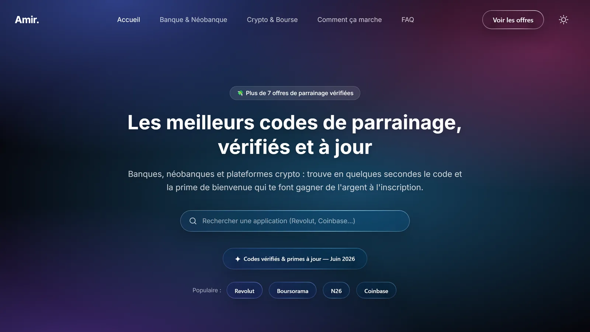
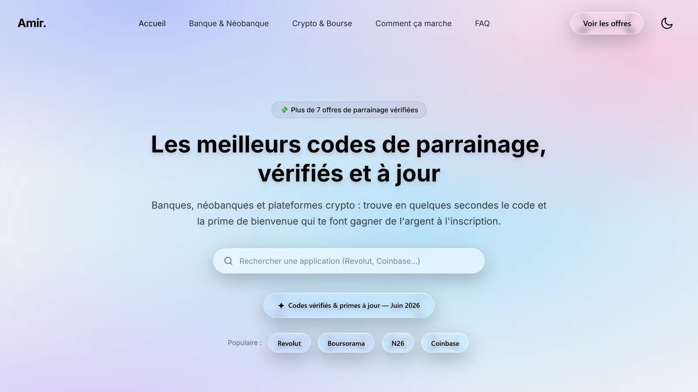
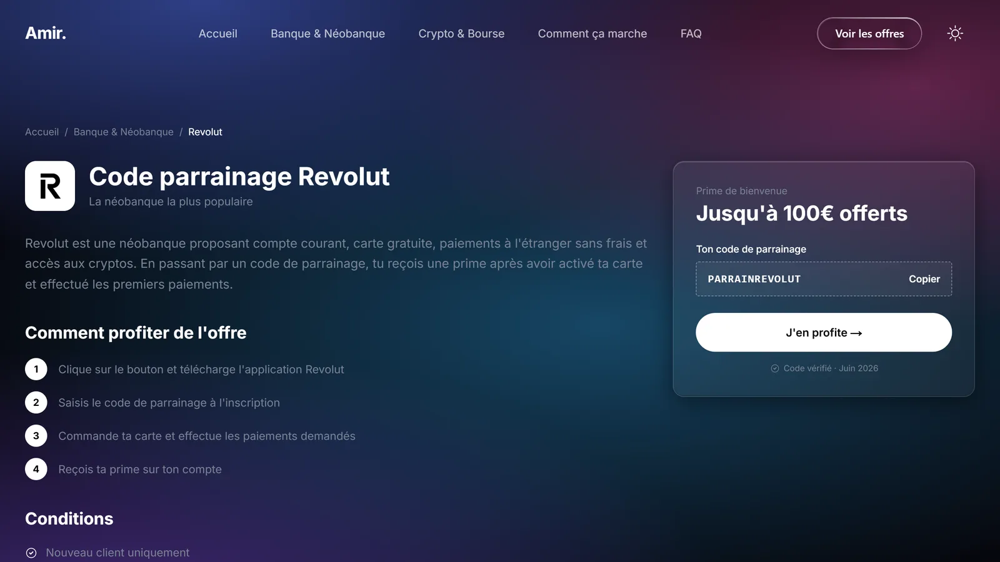

# Annuaire de codes de parrainage

Site web personnel qui regroupe des **codes de parrainage vérifiés** pour les banques, néobanques et plateformes crypto (Revolut, BoursoBank, N26, Trade Republic…). En quelques secondes, le visiteur trouve l'application qui l'intéresse, copie le code et découvre la prime de bienvenue.

Projet conçu et développé seul par **Amir Chouchane**, étudiant en BTS SIO, dans le cadre de son apprentissage du développement web.



| Mode jour | Page d'une offre |
| --- | --- |
|  |  |

## Fonctionnalités

**Côté visiteur**
- Recherche instantanée d'une application depuis la page d'accueil
- Navigation par catégories (*Banque & Néobanque*, *Crypto & Bourse*) et page « Toutes les offres »
- Une page par offre : prime, étapes pour en profiter, conditions et bouton « Copier » le code
- Mode jour / nuit (mémorisé), fond animé et effets « verre liquide »
- Pages FAQ, « Comment ça marche », mentions légales, confidentialité et cookies

**Espace d'administration** (`/admin`, protégé par mot de passe)
- Ajout, modification et suppression des offres et des catégories, sans toucher au code
- Réorganisation de l'ordre d'affichage des offres
- Upload des logos (les logos qui ne servent plus sont supprimés automatiquement)
- Statistiques : nombre de copies de chaque code et date de la dernière copie

**Sécurité et référencement**
- Connexion admin par mot de passe défini dans une variable d'environnement (refusé s'il est trop faible), comparaison à temps constant et cookie de session
- Plan du site (`sitemap.xml`), `robots.txt`, balises de partage et image d'aperçu générée automatiquement (1200 × 630)

## Technologies

| | |
| --- | --- |
| Framework | [Next.js 16](https://nextjs.org) (App Router, routes API) |
| Interface | React 19, TypeScript |
| Style | Tailwind CSS 4, `next-themes` (mode jour / nuit) |
| Données | Fichiers JSON (`src/data/db.json`, `src/data/stats.json`) |

## Lancer le projet en local

Prérequis : [Node.js](https://nodejs.org) 20 ou plus récent.

```bash
git clone https://github.com/Reiner916/codes-parrainage.git
cd codes-parrainage
npm install
```

Créer un fichier `.env.local` à la racine :

```bash
# Mot de passe de l'espace admin (8 caractères minimum, obligatoire pour s'y connecter)
ADMIN_PASSWORD=un-mot-de-passe-solide
# Adresse publique du site (sert au plan du site et aux aperçus de partage)
NEXT_PUBLIC_SITE_URL=http://localhost:3000
```

Puis :

```bash
npm run dev      # serveur de développement sur http://localhost:3000
npm run build    # version de production
npm run start    # lance la version de production
```

L'espace d'administration est accessible sur [http://localhost:3000/admin](http://localhost:3000/admin).

## Organisation du code

```
src/
├── app/                 Pages (accueil, catégories, offres, pages légales, admin) et routes API
│   ├── admin/           Tableau de bord et page de connexion
│   ├── api/admin/       Création / modification des offres et catégories, upload, connexion
│   └── api/track/copy/  Comptage des copies de codes
├── components/          Composants d'interface (Hero, offres, FAQ, admin…)
├── data/                Données du site (offres, catégories, statistiques, FAQ)
├── lib/                 Authentification, lecture / écriture des données, SEO, statistiques
└── types/               Types TypeScript (offre, catégorie)
```

## Hébergement

Les données sont enregistrées dans des fichiers JSON. Pour que l'espace admin et les statistiques fonctionnent en ligne, il faut un hébergement qui garde les fichiers modifiés (serveur ou VPS). Sur un hébergement « serverless » comme Vercel, la partie publique fonctionne, mais les modifications faites depuis l'admin ne sont pas conservées.

## Crédits et licence

Le projet est parti du modèle gratuit [Startup](https://github.com/NextJSTemplates/startup-nextjs) de NextJSTemplates (licence MIT), puis a été entièrement retravaillé : contenu, design, pages, espace d'administration, statistiques et SEO.

Distribué sous licence MIT (voir [LICENSE](LICENSE)).

## Auteur

**Amir Chouchane** · étudiant en BTS SIO, en recherche d'alternance en développement web et support informatique

- GitHub : [@Reiner916](https://github.com/Reiner916)
- LinkedIn : [amir-chouchane](https://www.linkedin.com/in/amir-chouchane)
- E-mail : [am.ch951@gmail.com](mailto:am.ch951@gmail.com)
