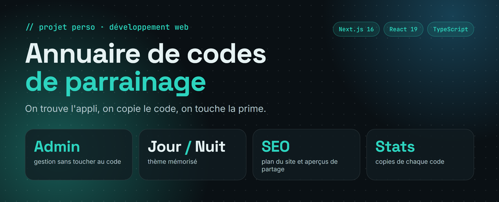
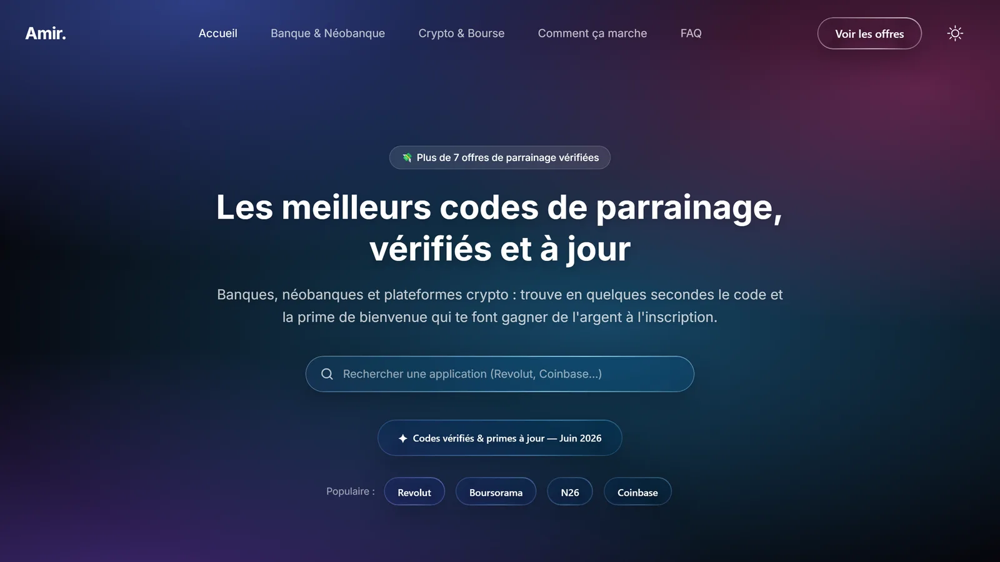
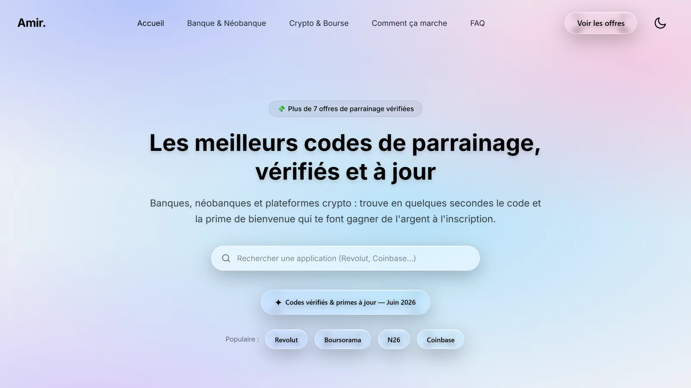
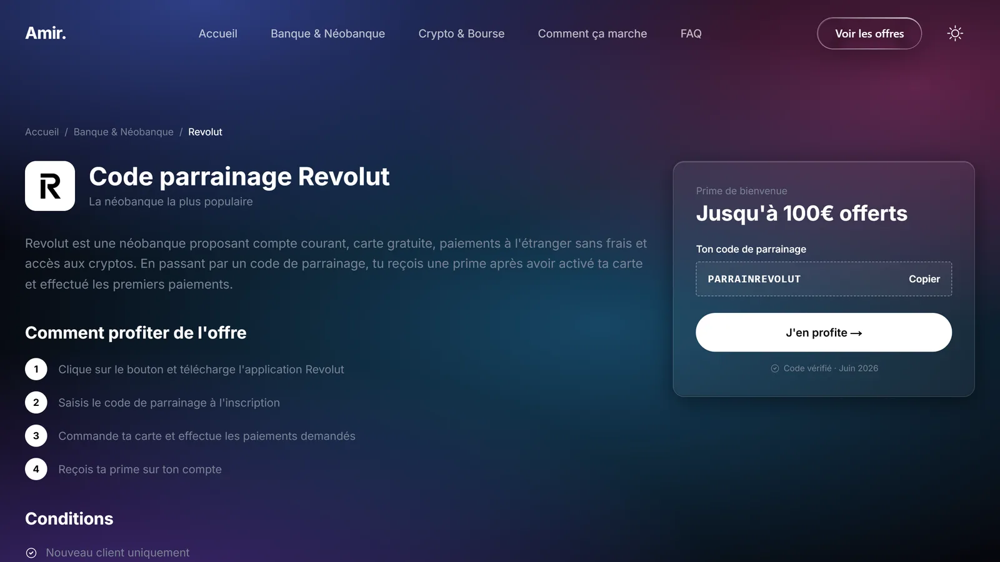

<p align="center">
  
</p>

<p align="center">
  
  
  
  
  
</p>

> 🔎 Un site qui regroupe des **codes de parrainage vérifiés** pour les banques, néobanques et plateformes crypto (Revolut, BoursoBank, N26, Trade Republic…).
> En quelques secondes, on trouve l'appli, on copie le code et on découvre la prime de bienvenue.

Projet conçu et développé seul par **Amir Chouchane**, étudiant en informatique.



| ☀️ Mode jour | 📄 Page d'une offre |
| --- | --- |
|  |  |

## ✨ Fonctionnalités

**👤 Côté visiteur**
- 🔍 Recherche instantanée d'une application depuis l'accueil
- 🗂️ Catégories (*Banque & Néobanque*, *Crypto & Bourse*) et page « Toutes les offres »
- 📋 Une page par offre : prime, étapes, conditions et bouton **Copier**
- 🌗 Mode jour / nuit mémorisé, fond animé et effets « verre liquide »
- ❓ FAQ, « Comment ça marche », mentions légales, confidentialité et cookies

**🛡️ Espace d'administration** (`/admin`, protégé par mot de passe)
- ✏️ Ajout, modification et suppression des offres et catégories, sans toucher au code
- ↕️ Réorganisation de l'ordre d'affichage
- 🖼️ Upload des logos (les logos inutilisés sont supprimés automatiquement)
- 📊 Statistiques : nombre de copies de chaque code et date de la dernière copie

**🔐 Sécurité et référencement**
- 🔑 Mot de passe admin dans une variable d'environnement (refusé s'il est trop faible), comparaison à temps constant, cookie de session
- 🗺️ `sitemap.xml`, `robots.txt`, balises de partage et image d'aperçu générée (1200 × 630)

## 🛠️ Technologies

| | |
| --- | --- |
| Framework | [Next.js 16](https://nextjs.org) (App Router, routes API) |
| Interface | React 19, TypeScript |
| Style | Tailwind CSS 4, `next-themes` (mode jour / nuit) |
| Données | Fichiers JSON (`src/data/db.json`, `src/data/stats.json`) |

## 🚀 Lancer le projet en local

Prérequis : [Node.js](https://nodejs.org) 20 ou plus récent.

```bash
git clone https://github.com/Reiner916/codes-parrainage.git
cd codes-parrainage
npm install
```

Créer un fichier `.env.local` à la racine :

```bash
# Mot de passe de l'espace admin (8 caractères minimum, obligatoire pour s'y connecter)
ADMIN_PASSWORD=un-mot-de-passe-solide
# Adresse publique du site (plan du site et aperçus de partage)
NEXT_PUBLIC_SITE_URL=http://localhost:3000
```

Puis :

```bash
npm run dev      # http://localhost:3000
npm run build    # version de production
npm run start    # lance la version de production
```

🛡️ L'administration est sur [http://localhost:3000/admin](http://localhost:3000/admin).

## 📁 Organisation

```
src/
├── app/                 📄 Pages (accueil, catégories, offres, légal, admin) et routes API
│   ├── admin/           🛡️ Tableau de bord et connexion
│   ├── api/admin/       ✏️ Offres, catégories, upload, connexion
│   └── api/track/copy/  📊 Comptage des copies de codes
├── components/          🧩 Composants d'interface (Hero, offres, FAQ, admin…)
├── data/                📦 Offres, catégories, statistiques, FAQ
├── lib/                 ⚙️ Authentification, données, SEO, statistiques
└── types/               🏷️ Types TypeScript
docs/                    🖼️ Bannière et captures
```

## ☁️ Hébergement

Les données sont enregistrées dans des fichiers JSON. Pour que l'admin et les statistiques fonctionnent en ligne, il faut un hébergement qui garde les fichiers modifiés (serveur ou VPS). Sur un hébergement « serverless » comme Vercel, la partie publique fonctionne, mais les modifications faites depuis l'admin ne sont pas conservées.

## 📜 Crédits et licence

Parti du modèle gratuit [Startup](https://github.com/NextJSTemplates/startup-nextjs) de NextJSTemplates (licence MIT), puis entièrement retravaillé : contenu, design, pages, administration, statistiques et SEO.

Distribué sous licence MIT (voir [LICENSE](LICENSE)).

## 📬 Contact

**Amir Chouchane** · étudiant en informatique, en recherche d'alternance

- 💼 LinkedIn : [amir-chouchane](https://www.linkedin.com/in/amir-chouchane)
- 🐙 GitHub : [@Reiner916](https://github.com/Reiner916)
- ✉️ E-mail : [am.ch951@gmail.com](mailto:am.ch951@gmail.com)
- 🌐 Portfolio : [amir-chouchane.vercel.app](https://amir-chouchane.vercel.app)
